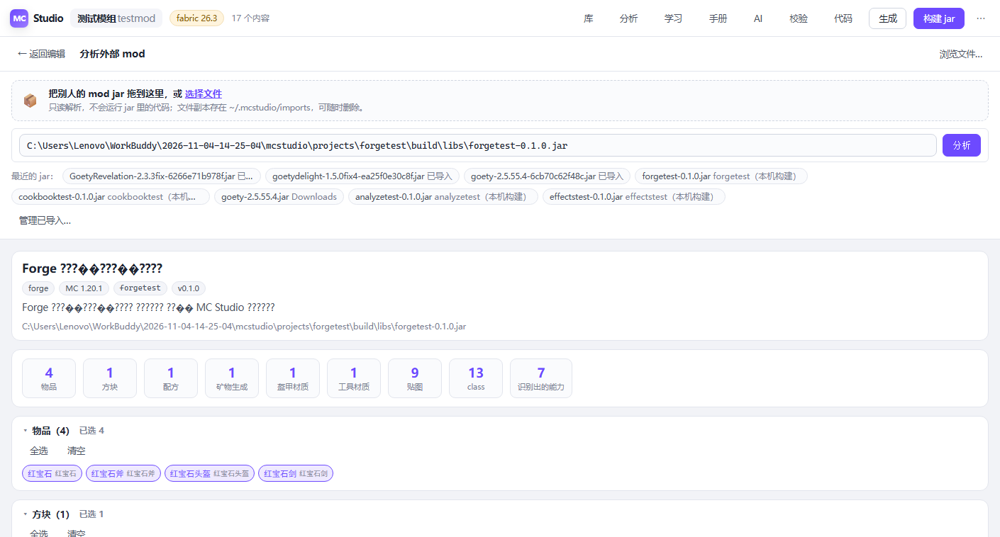

# MC Studio

Minecraft 模组可视化编辑器。**表单填内容 → 一键出 jar。**
零 npm 依赖，只用 Node 标准库。

> 不会写 Java 也能做出带物品、方块、配方、矿物生成的 mod；
> 会写代码的人可以在钩子里插自己的逻辑，少写一堆样板。


## 快速开始

**需要 Node.js 22.12+**（或 20.19+ 且开启了 `require(esm)`）。引擎用 `require(esm)` 同步加载目标适配器、转换规则与 mod 积木包插件；更低版本会在启动时明确报错，不会静默生成错工程。

```bash
node studio.mjs start
```

浏览器打开 `http://127.0.0.1:4173` 即可。**不需要 npm install**（本项目零依赖）。
Windows 上想双击启动，可以自己做一个 `.bat` 调 `node studio.mjs start --port 4173`。

首次进入点首页上手卡之一，跟着走就行：

| 你想干嘛 | 看哪张卡 |
|---|---|
| 拖积木写逻辑（不用写代码） | ① 我想用积木搭 |
| 做一个自己的 mod | ② 从零到出 jar |
| 拆解别人的 mod | ③ 导入 → 研究 → 改数值 |
| 系统了解一遍 | ④ 完整使用手册 |

## 它能做什么

**做内容** —— 物品、方块、配方、矿物生成、工具材质、盔甲材质、进度，
每种都有中文表单和实时贴图预览。改 id、贴图、属性，全是所见即所得。

**搭积木写逻辑** —— 不想写代码？顶栏「积木」，用 Scratch 式的拖积木拼程序：
事件帽 + 语句 + 条件槽，拖一拖就拼出模组逻辑。**生成出来的是真 Java**，
跟手写的类一样参与 Gradle 构建（Fabric 26.3 / Forge 1.20.1 都真编译验证过）。
画布上的积木**任意拖动**：从工具箱拖到语句链 / 容器 / 值槽的任意兼容位置，
`如果…那么` 里还能再套 `如果…那么`、条件里嵌 `与`/`或`/`非` 和数值比较，拖到垃圾桶删除。
界面里有个 11 步的**入门向导**，能替你一步步操作界面。


积木还能**打包成库**：

- 任意 mod 的 jar 拖进去 → 自动生成一套积木库（物品 / 方块 / 效果 / 可调用的功能）
- 一段 Java 写好 →「代码造积木」变成带参数的积木块 → 导出 `.mcblocks.json` 分享给别人

本机已经装好三个 Goety 模组的库（135 + 19 + 32 = 186 条积木）。

**做校验** —— 生成前自动检查：id 重复、引用了不存在的材质、配方格式不合法，
一次性把问题列全，不用一次次试错。

**出 jar** —— 一键调 Gradle 真编译（Fabric 26.3 用 JDK 25，Forge 1.20.1 用 JDK 17），
日志实时滚，成功后可直接部署到客户端 mods 目录。


**复用** —— 做好的内容和代码钩子打包成 `.mcpkg.json` 存起来，
下个工程一键装进去，id 撞了自动改名并同步所有引用。


**搬功能到别的版本 / 加载器** —— 顶栏「**转换**」，把当前工程、一段 Java、
内置效果或分享包里的功能尽量搬到另一个目标（如 Fabric 26.3 → Forge 1.20.1）。
有证据的写法（积木模板、资源 id 类、注册表方法）自动改；加载器事件、注册入口、
本地 jar 这类**不敢硬改**的会明确标「需人工」并写 `// TODO(转换)`，附目标平台的做法提示。
报告分四档：`自动完成 / 已改写 / 需人工 / 做不到`，应用前可预览、应用后重出资源再构建验证。
规则可插拔，详见[《10 · 功能转换器》](docs/guides/10-转换器插件.md)。

**拆别人的 mod** —— 把别人的 jar **拖进面板**就能解析：
读出它有什么内容、挂了哪些事件、依赖谁，勾选后转成包直接复用。
支持 Fabric / Quilt / Forge / NeoForge / 老 `mcmod.info`，
带签名的、内嵌 jar 的、中文文件名的都能读。



**学得会** —— 内置知识库（指南 / 速查 / 任务卡）可搜可跳，
标注了适用平台和证据等级；AI 助手读得到这些内容，流式回答，
问 Forge 工程不会再得到 26.3 的写法。


## 目标平台

新建工程时在欢迎页下拉里选目标，已内置两个：

| 目标 id | 加载器 | MC | JDK | 构建 | 真编译验证 |
|---|---|---|---|---|---|
| `fabric-26.3` | Fabric Loader 0.19.5 | 26.3 | 25 | Loom + Gradle 9.5.1 | `tests/cookbook.mjs --build` |
| `forge-1.20.1` | Forge 47.4.0 | 1.20.1 | 17 | ForgeGradle 6.x + Gradle 8.8 | `tests/forge.mjs --build` |

工程把选中的目标完整写进 `.studio/project.json` 的 `target`（含 `id` 与适配器专属字段）。
老工程只有 `platform + mcVersion`，加载时会自动补 `id`。

**加一个目标**：写 `core/target/<id>/adapter.mjs` 并在 `core/target/registry.mjs` 登记一行，
目标就会出现在清单里（也可以丢进 `~/.mcstudio/targets/` 自动发现）。但要让新目标**真正可用**，
还得补三样：积木库的 Java 模板（内置积木目前只写了这两个目标）、资源方言分支
（`features.resourceFormat` 目前是「1.20.1 / 其它」二值）、以及转换规则的符号映射。
目前内置的完整支持只有 `fabric-26.3` 与 `forge-1.20.1` 两个目标。
版本方言（`models/item` vs `items`、`recipes` vs `recipe`、`loot_tables` vs `loot_table`、
盔甲贴图路径、配方 `result` 形状……）由生成器按适配器的 `features.resourceFormat` 分派，
内容模块不需要判断版本号。细节见 [`docs/module-guide.md`](docs/module-guide.md)。

**已有工程想换目标**：用顶栏「转换」做一次预览再应用，它会把 `target` 换成新目标的默认值
（保留你自定义的扩展字段）、改写代码钩子里的平台差异写法，并把不敢自动改的地方列成
「需人工」清单；报告会明确写出「这次没检查什么」，应用前自动备份 `.studio/project.json`。
应用后再生成 + 构建。详见[《10 · 功能转换器》](docs/guides/10-转换器插件.md)。

## 文档

- **用户手册**：[`docs/README.md`](docs/README.md)
- **完整手册**（八章 + 速查表，与应用内学习中心同源）：[`docs/guides/00-使用手册.md`](docs/guides/00-使用手册.md)
- **积木编程入门**（手把手搭第一个模组）：[`docs/guides/08-积木编程入门.md`](docs/guides/08-积木编程入门.md)
- **积木编程**（积木库、代码造积木、从 mod jar 生成库）：[`docs/guides/07-积木编程.md`](docs/guides/07-积木编程.md)
- **扩展与工具包**（加新平台、写专属积木包、命令行工具箱）：[`docs/guides/09-扩展与工具包.md`](docs/guides/09-扩展与工具包.md)
- **拆解别人的 mod**（导入 → 研究 → 改数值真生效）：[`docs/guides/06-拆解别人的mod.md`](docs/guides/06-拆解别人的mod.md)
- **模块开发 / 加新版本**：[`docs/module-guide.md`](docs/module-guide.md)
- **复用与分析**（效果库、包、导入别人的 mod）：[`docs/reuse-and-analysis.md`](docs/reuse-and-analysis.md)
- **知识库与 AI 助手**：[`docs/knowledge-and-ai.md`](docs/knowledge-and-ai.md)

应用内的「学习」面板能搜到以上全部内容 —— 不用离开工具就能查。

## 目录

```
core/                  引擎（纯 Node 模块，不碰 DOM）
  target/              目标适配器注册表（内置 + 自动发现 ~/.mcstudio/targets）
    fabric-26.3/       Fabric 26.3：骨架、Java 生成、26.x 资源方言
    forge-1.20.1/      Forge 1.20.1：官方 MDK 骨架、Java 生成、1.20.1 资源方言
  visual/              可视化积木引擎：定义 / 模型 / 编译 / 反编译 / 库 / 体检
    modpacks/          mod 专属积木包（可插拔，内置 Goety + 用户目录自动发现）
  convert/             功能转换器：IR / 引擎 / 规则注册表
    rules/             内置转换规则（模板回填 / 符号 / 事件 / 资源方言 / 条目 / 积木 / 依赖）
  cli/                 命令行子命令（blocks / convert / tools 索引）
  generator/           通用生成流水线：资源 JSON、贴图、写盘与指纹
  modules/             模块注册表（扫描 modules/ 与 <工程>/.studio/modules）
  library/             效果包：Pack 格式、包库、捕获、安装、内置效果模板
  analyze/             分析器：ZIP 读取、第三方元数据、导入缓存、class 常量池、资源反推、能力识别
  knowledge/           知识库：文档解析、来源发现、章节级检索、分析沉淀
  ai/                  模型接入：三家协议适配、按平台拼上下文、错误分类
  hooks/               代码钩子（Java 锚点 + JS 钩子）+ 装钩子前的静态检查
  build/               Gradle 集成
  serve/               本地 HTTP 服务 + 贴图/Blockbench 辅助
ui/                    前端（纯静态，零依赖，只通过 /api 通信）
knowledge/             内置知识库：指南 / 速查 / 任务卡（随项目走，可读可搜）
modules/               内置内容模块：物品 / 方块 / 配方 / 世界生成 / 材质 / 进度
tests/                 回归用例
examples/extend/       可照抄的扩展样板（也是回归测试夹具）
docs/                  文档
tools/                 一次性脚本与工具，`node studio.mjs tools` 列索引
```

引擎和界面是彻底分开的：`studio.mjs` 的每个命令都直接调引擎，
界面只是换了个壳。要迁到 Electron / VSCode / CI 都只换壳不动引擎。

## 复用与分析

顶栏有两个整屏面板：

- **库** —— 把工程里的内容（连同它引用的材质、贴图）、把一套代码钩子，打包成一个 `.mcpkg.json`
  存起来；下个工程一键装进去，id 撞了自动改名并同步所有引用。
- **分析** —— **把别人的 mod jar 直接拖进面板**就能解析（也可以手填路径 / 浏览磁盘 / 点最近的构建产物）。
  读出它有什么内容、挂了哪些事件，勾选后转成包直接复用。第三方发布包支持
  Fabric / Quilt / Forge / NeoForge / 老 `mcmod.info`，带签名的、内嵌 jar 的、中文文件名的都能读；
  报告会明说是发布版（只有 .class）还是源码包。代码不抄，给的是等价的、能编译的参数化实现。

包库分三层：用户级 `~/.mcstudio/packs`、工程级 `<工程>/.studio/packs`、只读内置。
一个包一个 json 文件，没有数据库，索引就是扫目录。

## 命令行工具箱

界面里的积木能力**全都有命令行入口**，可以直接接 CI 或写进脚本：

```bash
node studio.mjs blocks help                       # 全部用法
node studio.mjs blocks targets / packs           # 目标、mod 专属积木包清单（含外部发现的）
node studio.mjs blocks list --target forge-1.20.1
node studio.mjs blocks compile projects/mymod --out /tmp/ModLogic.java
node studio.mjs blocks from-jar SomeMod.jar --out MyBlocks.mcblocks.json
node studio.mjs blocks validate MyBlocks.mcblocks.json   # 分享前体检
node studio.mjs blocks install MyBlocks.mcblocks.json
node studio.mjs blocks new --name "治疗" --id my.heal --code 'player.heal(%v);' --param v:number
node studio.mjs convert rules / matrix           # 转换规则与能力矩阵
node studio.mjs convert run projects/mymod --to forge-1.20.1 --out /tmp/Converted.java
node studio.mjs convert apply projects/mymod --to forge-1.20.1 --yes --generate
node studio.mjs tools                           # tools/ 脚本索引
```

命令都支持 `--json` 和明确的退出码，坏库能直接让流水线挂掉：

```bash
node studio.mjs blocks validate dist/*.mcblocks.json || exit 1
```

三个扩展点**不用改引擎源码**：把适配器丢进 `~/.mcstudio/targets/`、
把积木包丢进 `~/.mcstudio/modpacks/`、把转换规则丢进 `~/.mcstudio/convert/`，
引擎启动时自动发现。可照抄的样板在 `examples/extend/`，契约见
[《09 · 扩展与工具包》](docs/guides/09-扩展与工具包.md)，
转换器用法见[《10 · 功能转换器》](docs/guides/10-转换器插件.md)。

## 学习中心与 AI

顶栏的 **学习** 和 **AI** 是两个整屏面板，解决的是「不会写 Java 的人怎么把想法做成能编译的代码」
和「会写的人怎么少翻文档」。

- **学习** —— 内置知识库：10 篇指南、速查、任务卡，每篇都标了 `platform` 与证据等级。
  Fabric 26.3 部分在本机实编验证；Forge 1.20.1 部分由官方 MDK 解包 + `javap` 复核 +
  ForgeGradle 真编译背书。检索按**章节**而不是按文档，并按当前工程平台加权。
  如果本机装了 MC 开发专家包，会自动挂进来一起搜（那个是全平台的，按平台调权重不硬过滤）。
- **AI** —— 接 OpenAI 兼容 / Anthropic / Ollama 三条路，key 只存本机、不回前端。
  每次提问带三块上下文：**按工程目标切换**的平台事实、当前工程摘要（含 `target.id`）、
  检索到的知识片段（带平台标注）。问 Forge 工程不会再得到 26.3 的 `setId()` 写法。
- **代码块 → 装成钩子** —— AI 回答和学习中心里的 Java 代码块可以点「装成钩子」：
  先做静态检查、给出**真实落点**预览，用户确认后才写进工程配置；再点「生成」才插进 Java，
  再「构建」才生效。任何一步都不会偷偷改源码。
- **沉淀** —— 分析完别人的 mod，在分析面板点「存成笔记」，这份笔记就进知识库，
  以后能搜到、AI 能引用。知识不是写死的，是用出来的。

细节见 [`docs/knowledge-and-ai.md`](docs/knowledge-and-ai.md)。

## 自检

一条命令跑全量快测（不跑 Gradle / 浏览器）；`npm test` 等价于第一条：

```bash
node tests/run.mjs                     # 快测汇总，任一用例挂掉退出码非 0
node tests/run.mjs --build             # 加上所有 --build 真编译用例
node tests/run.mjs --all               # 再加 Gradle 骨架构建 + 浏览器冒烟（要先起服务）
node tests/run.mjs --only convert      # 只跑文件名含 convert 的用例
node tests/run.mjs --json              # 结构化结果给 CI

node tests/smoke.mjs projects/testmod     # 灌数据 → 生成 → 断言资源格式 → 检查指纹冲突
node tests/uitest.mjs                     # 无头浏览器点一遍所有页面，收集 JS 报错
node tests/uitest.mjs --build             # 额外真跑一次 gradle 构建
node tests/uitest.mjs --install           # 额外把包真装进工程（默认只到预览，避免污染工程）
node tests/pack.mjs                       # 捕获 → 存库 → 安装 → 撞名改名 → 参数替换
node tests/hooks.mjs                      # 代码块 → 预览（只读）→ 确认红线 → 装钩子 → 生成 → 清理
node tests/effects.mjs --build            # 7 个内置效果模板真编译
node tests/analyze.mjs                    # 分析真实 jar → 转包 → 装进空工程 → 生成
node tests/import.mjs                     # 第三方 jar：ZIP 怪癖 / 元数据 / 上传 / 内嵌展开 / 删除
node tests/knowledge.mjs                  # 知识库：索引 / 平台加权 / id 唯一 / 预算 / 沉淀
node tests/ai.mjs                         # AI：三家协议（整段+流式）/ 错误分类 / SSE / 平台上下文
node tests/cookbook.mjs --build           # Fabric 任务卡代码真编译 + 变体符号核对
node tests/forge.mjs --build              # Forge 1.20.1 骨架 + 2 张 Forge 任务卡真编译
node tests/generality.mjs                 # 分析器通用性：换任何 mod 都不大面积踩坑
node tests/extensible.mjs                 # 目标 / modpack / 自定义积木 / lint / CLI / 工具索引
node tests/runtime.mjs                    # 运行时契约：低版本 Node 必须显式报错，不静默降级
node tests/security.mjs                   # 服务边界：跨站 Origin / 任意 Gradle 任务 / 越界写
node tests/convert.mjs                    # 转换器：IR / 规则 / 双向转换 / CLI / HTTP / 应用 / 备份 / 生成
node tests/convert.mjs --build            # 额外对转换后的 Forge 工程真跑 Gradle
node tests/docs.mjs                       # 文档一致性：与知识库同源 + 链接全有效
node tests/tutorial.mjs                   # 上手入口：首页三卡 → 知识库 → 打开对应文档
```

`--build` 的用例会真跑 Gradle，需要对应目标的 JDK（Fabric 26.3 → 25，Forge 1.20.1 → 17）。

`analyze` / `inspect` 需要一个真实的 mod jar 当样本，仓库自带一个
（`tests/fixtures/samplemod-0.1.0.jar`，用 `node tools/make-sample-mod.mjs` 造的）。
想测自己的 jar：`node tests/analyze.mjs /path/to/your-mod.jar`。

## 许可

MIT，见 [`LICENSE`](LICENSE)。

